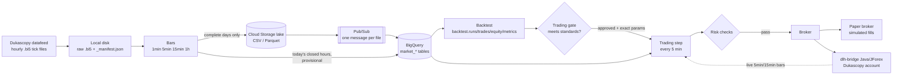
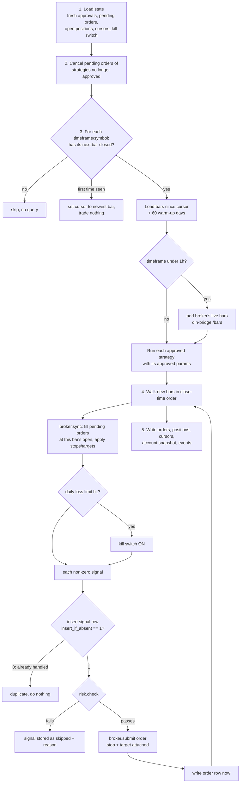
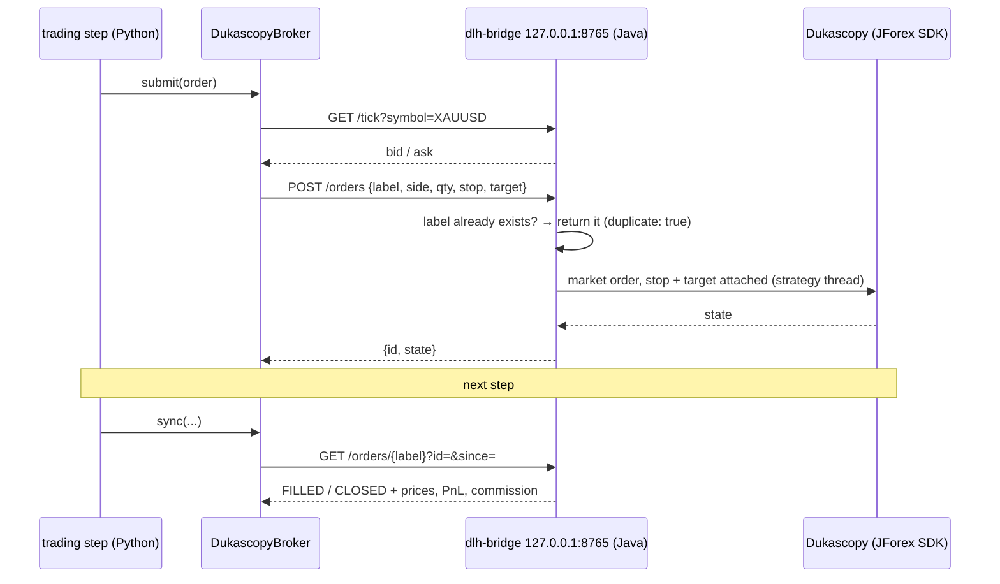
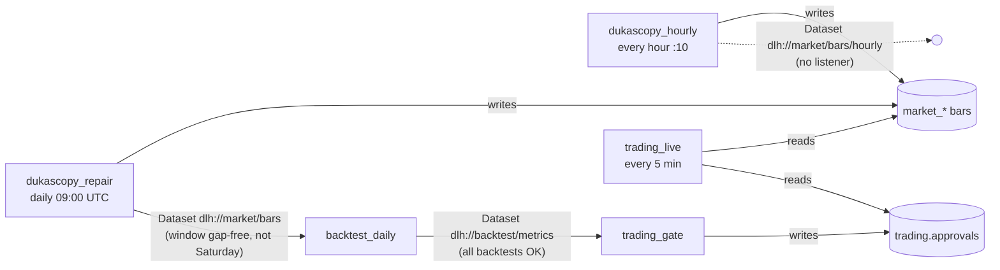
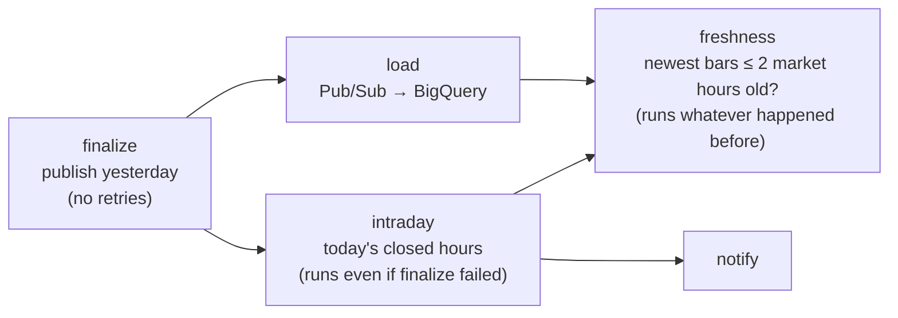

# DLH: how the whole system works

A plain-language tour of the project: what each part does, how data moves from Dukascopy to a
trade, what runs when, and every safety rule that keeps it correct. Written from the code on
branch `backtest` at commit `fb21430` (4 Nov 2026).

Contents

1. [The big picture](#1-the-big-picture)
2. [What each commit added, and why](#2-what-each-commit-added-and-why)
3. [The complete flow, step by step](#3-the-complete-flow-step-by-step)
4. [The Airflow DAGs and what triggers them](#4-the-airflow-dags-and-what-triggers-them)
5. [Local emulation vs real GCP](#5-local-emulation-vs-real-gcp)
6. [Every safety feature, explained](#6-every-safety-feature-explained)
7. [Every feature: CLIs, strategies, metrics, settings](#7-every-feature-clis-strategies-metrics-settings)
8. [Known limits](#8-known-limits)

---

## 1. The big picture

DLH does three jobs, one after another:

1. **Collect market data.** Download price ticks for each symbol (default `XAUUSD`, gold) from
   Dukascopy's free public datafeed, turn them into bars (candles) of several sizes, store them
   in a data lake (Cloud Storage), announce each file on Pub/Sub, and load it into the warehouse
   (BigQuery).
2. **Test strategies.** Every day, replay each trading strategy over the last two years of bars
   (a *backtest*) and score it: return, Sharpe, drawdown, and so on.
3. **Trade the good ones.** A *gate* approves only strategies whose latest backtest meets your
   standards. Every 5 minutes a *trading step* turns approved strategies' signals on new bars
   into orders, after risk checks, with a broker: the **paper broker** (simulated) or a real
   **Dukascopy account** through a small Java service, **dlh-bridge**.

Everything runs either on your laptop with GCP **emulated on disk**, or on **real GCP**, with
the same code. Airflow schedules it all.



### Where things live

| Folder | What it is |
|---|---|
| `cloud/` | The storage/messaging/warehouse layer. `base.py` defines three interfaces (`ObjectStorage`, `PubSub`, `Warehouse`); `local/` and `gcp/` implement them. |
| `ingestion/dukascopy/` | Downloading ticks, turning them into bars, publishing and loading. |
| `backtest/` | Strategies, the simulation engine, metrics, the runner that stores results. |
| `trading/` | The gate, the trading step (executor), risk rules, brokers, the trading tables. |
| `bridge/` | dlh-bridge: one Java file on the Dukascopy JForex SDK, an HTTP service on `127.0.0.1`. |
| `airflow/dags/` | The schedules. Thin files; real logic is in `airflow/plugins/dlh_tasks.py`. |
| `tests/` | 95 tests, all offline (fake Dukascopy clients, temp folders). |

---

## 2. What each commit added, and why

Oldest first.

| Commit | Date | What it added | Why |
|---|---|---|---|
| `da3cf59` Initial commit | 27 Oct | The pipeline: Dukascopy client (rate limiting, retries), downloader with manifests, tick → bar conversion, publish to GCS + Pub/Sub, load into BigQuery, resumable backfill, `cloud/` with local and GCP backends, the `cloud` inspection CLI, `dukascopy_daily` and `dukascopy_setup` DAGs. | Get reliable market data into a warehouse, testable on a laptop without GCP. |
| `7a130a8` Backtest package | 29 Oct | `backtest/`: `supply_demand` and `trendline` strategies, the engine, metrics, runner, `python -m backtest`. Results in their own `backtest` dataset, written by `run_id`. | Score strategies on the loaded bars; re-runs replace instead of duplicate. |
| `d32c674` backtest_daily DAG | 29 Oct | A DAG that re-runs `BACKTEST_DAILY_RUNS` every day over the last `BACKTEST_DAILY_LOOKBACK_DAYS`, with fixed run_ids per day. | Keep backtest scores up to date automatically. |
| `e3b965f` Readable equity columns | 29 Oct | `side`, `lots`, `note` on every equity row (LONG/SHORT, size in lots, "entry", "closed: stop (-12.30)"…). | Make the equity table readable by a human. Trades that open and close in one bar show only in the note. |
| `6c32b67` Repair DAG + typed errors | 30 Oct | `dukascopy_repair` (09:00 UTC) back-fills missing days of the last 7. Download errors get a *kind* (SSL, DNS, TIMEOUT, CONNECTION, RATE_LIMIT, SERVER, HTTP, CORRUPT) with a hint. | Days missed by downtime or failed retries used to stay missing. Error messages like "2 failed files" said nothing useful. |
| `e4cb49d` CLAUDE.md | 30 Oct | Project guide. | Documentation. |
| `2bdbb1b` Backtest after repair | 30 Oct | `backtest_daily` is now triggered by `dukascopy_repair`, only once the repair window has no gaps. | Backtests must never run over missing days. |
| `95d318e` Trading layer | 2 Nov | `trading/` (gate, executor, risk, paper broker, store, tables), `dukascopy_hourly` (today's closed hours as provisional bars), `trading_gate`, `trading_live`, and two new warehouse methods `upsert_from_dataframe` / `insert_if_absent`. | Trade strategies that pass the standards, with every decision recorded and no double orders. |
| `ab732d0` finalize replaces dukascopy_daily | 2 Nov | `dukascopy_hourly` becomes the only scheduled download: `finalize` publishes yesterday from the tick hours already cached, `load` loads it, `intraday` loads today. DAGs always build from ticks. | Two DAGs downloaded the same day twice, possibly from different sources (ticks vs candles), so the lake and trading could disagree. |
| `e73988d` Never publish an unfinished day | 2 Nov | `publish_day` refuses any day after yesterday (UTC); backfill stops at yesterday; repair's window ends at yesterday. | Hours that haven't happened yet download as *empty*, so today looked "clean". A manual run could publish a partial day, which then stayed partial forever. |
| `e0cd376` Dukascopy broker | 3 Nov | dlh-bridge (Java, JForex SDK) and `trading/brokers/dukascopy.py`; `python -m trading broker-check`. | Trade a real (demo) Dukascopy account. |
| `d43901e` Broker's own equity | 3 Nov | Account snapshot uses the broker's equity when it has one. | With Dukascopy, the snapshot ignored anything done outside DLH (test orders, manual trades, swaps, fees). |
| `d4d8f6f` silver_bullet + breakout | 3 Nov | Two new strategies. `breakout` passes the gate on XAUUSD 1h over two years; `silver_bullet` doesn't on 5min/1min. | More strategies to test. |
| `5007cfd` Live sub-hour bars | 4 Nov | dlh-bridge serves closed bars (`GET /bars`); `trading_live` runs every 5 minutes; timeframes under 1h get the broker's live bars; nothing faster than 5min may trade; `silver_bullet` refuses bars slower than 15min. | The warehouse only gets bars once an hour, so a 5min signal arrived up to an hour late and was skipped as stale. |
| `fb21430` freshness task | 4 Nov | `freshness` task in `dukascopy_hourly` fails when the newest bars are more than `DUKASCOPY_MAX_LAG_HOURS` (2) market-open hours old. | A stalled feed was silent: trading just saw no new bars and everything stayed green. |

---

## 3. The complete flow, step by step

### 3.1 Download (`ingestion/dukascopy/client.py`, `downloader.py`)

Dukascopy publishes one file per symbol per hour:
`…/XAUUSD/2026/10/03/14h_ticks.bi5` (note: months count from 0). Each file is LZMA-compressed
and holds 20-byte records: milliseconds into the hour, ask, bid, ask volume, bid volume. Prices
are whole numbers that get divided by a per-symbol *point factor* (`instruments.py`; e.g. gold
uses 1000).

`download_day(symbol, day)` fetches the 24 hours of a day (in parallel, `DUKASCOPY_MAX_WORKERS`
threads) into `data/raw/XAUUSD/2026-11-03/` and **decodes every file right away**, so a broken
file is caught now, not later. It writes a `_manifest.json` with one line per hour:

- `ok`: ticks found (count, first/last time and price);
- `empty`: no ticks (closed market, or not published yet);
- `failed`: download error, with its kind (SSL, DNS, TIMEOUT, …);
- `corrupt`: not a valid `.bi5` (for example a proxy's HTML page).

Files already on disk are reused; only missing hours are fetched. `until=` limits the day to
hours that have already ended (used by the hourly load).

### 3.2 Ticks → bars (`converter.py`, `transform.py`)

The ticks of a day become OHLCV bars for every timeframe in `DUKASCOPY_BAR_TIMEFRAMES`
(default `1min, 5min, 15min, 1h`), on one price side (`DUKASCOPY_BAR_PRICE_SIDE`: bid, ask or
mid; bid matches MT5). Each row also gets `symbol`, `date`, `timeframe`, `price_side` and
`ingested_at`. (The CLI can instead build bars from Dukascopy's daily 1-minute candle files,
`DUKASCOPY_BAR_SOURCE=candles`: 2 requests per day instead of 24. The DAGs always use ticks.)

### 3.3 Publish to the lake and Pub/Sub (`pipeline.publish_day`)

For a **complete, finished** day only (see safety rules), each dataset (`ticks`, `bars_1min`,
`bars_1h`, …) is written to the lake as one file:

```
gs://{bucket}/dukascopy/{csv|parquet}/{dataset}/symbol=XAUUSD/date=2026-11-03/part-0.csv
```

and one Pub/Sub message announces it: `{uri, dataset, table, symbol, date, rows}`. Optionally
the raw `.bi5` files are copied too (`DUKASCOPY_UPLOAD_RAW`).

### 3.4 Load into BigQuery (`pipeline.load_pending`)

The loader pulls messages and, for each one, **replaces** that symbol/day in the target table
with the file's contents. It checks the loaded row count equals the message's `rows`. Only then
does it *ack* the message. Failed messages are left un-acked and Pub/Sub delivers them again
later.

Tables: ticks in `market.dukascopy_ticks`; bars in one dataset per timeframe:
`market_1min.dukascopy_bars`, `market_5min…`, `market_15min…`, `market_1h…`. Tables are
partitioned by `date`.

### 3.5 Today's bars, early (`pipeline.load_intraday`)

The lake only takes finished days, but trading needs today's bars. So every hour at :10 the
`intraday` task downloads today's hours **up to the last closed hour**, builds bars, keeps only
bars that have **fully closed** (a 1h bar still forming is dropped), and writes them straight
into the `market_*` tables, replacing that symbol/day. These rows are **provisional**: they skip
the lake and Pub/Sub, and the next day's `finalize` + `load` replaces them with the complete day.
A day already in the lake is never touched.

### 3.6 Backtest (`backtest/runner.py`, `engine.py`, `metrics.py`)

For one strategy, timeframe and date range, per symbol:

1. load bars from the warehouse;
2. run the strategy → one row per bar with `signal` (+1 long, −1 short, 0), `stop`, `target`;
3. simulate (engine rules in §6.4);
4. compute metrics;
5. write `backtest.runs`, `trades`, `equity`, `metrics`, all keyed by `run_id`.

The `runs` row is written first as `running`, then updated to `done` or `failed` (with the
error), so a crashed run is visible. It also stores the exact parameters (`params_json`), the
git commit (`git_sha`) and the newest data it read (`data_cutoff`), so a run can be reproduced.
Daily runs have `run_id = daily-{strategy}-{timeframe}-{date}`.

### 3.7 Gate (`trading/gate.py`)

For each (strategy, timeframe, symbol), take the newest **done** run whose id starts with
`daily-` and check its metrics against the `TRADING_MIN_*` / `TRADING_MAX_*` standards. Pass →
`approved`, storing that run's exact parameters. Fail → `rejected`, with every failed check in
`reasons` (e.g. `sharpe 0.40 < 1.00; max_drawdown -25.0% worse than -15.0%`). A strategy that was
approved and now fails is `revoked` (logged in `trading.events`).

### 3.8 One trading step (`trading/executor.py`)

This runs every 5 minutes (`trading_live`) or by hand (`python -m trading step`).



Details worth knowing:

- **Cursor:** for each timeframe/symbol, the newest bar already processed. A step only acts on
  bars after it. The first time a timeframe/symbol is seen, the step only sets the cursor:
  trading starts with bars that arrive *after* that, never on history.
- **Skipping cheaply:** if `cursor + 2 × timeframe > now`, the next bar can't have closed, so
  that timeframe/symbol is skipped without a warehouse query. Result: 5min is pulled every run,
  15min every third run, 1h once its hour is loaded.
- **Warm-up:** 60 days (`TRADING_WARMUP_DAYS`) of earlier bars are loaded so indicators and zones
  match what the backtest would have computed.
- **Order of events on a bar:** fill orders and check exits first, then the daily loss limit,
  then new signals. A new order fills on the *next* bar's open, like the backtest.

### 3.9 Brokers (`trading/brokers/`)

All brokers implement `submit`, `sync`, `unrealized`, and optionally `balance`, `equity`, `bars`.
Orders are market orders **with the stop and target attached**.

| | Paper (`paper.py`) | Dukascopy (`dukascopy.py` + `bridge/`) |
|---|---|---|
| `realtime` | `False`: replays every new bar | `True`: acts only on the newest bar |
| Fills | next bar's open, with the backtest's spread and commission | live market price at Dukascopy |
| Size | risk / (fill − stop) | risk / (live ask or bid − stop), rounded *down* by the bridge to the instrument's step (gold: 1 oz) |
| Balance / equity | computed from `TRADING_PAPER_CAPITAL` + recorded PnL | read from the real account |
| Live bars | none | `GET /bars` from the JForex feed |



---

## 4. The Airflow DAGs and what triggers them

| DAG | When | Tasks | Notes |
|---|---|---|---|
| `dukascopy_setup` | by hand | `setup` | Creates bucket, topic, subscription, datasets and tables. |
| `dukascopy_hourly` | every hour at :10 | `finalize` → `load`, `intraday` → `notify`; `freshness` last | The only scheduled download. Emits `dlh://market/bars/hourly` (nothing listens to it now). |
| `dukascopy_repair` | daily 09:00 UTC | `repair` → `trading_day` → `notify` | Back-fills gaps in the last 7 days. Emits `dlh://market/bars` only when the window is gap-free and it isn't Saturday. |
| `backtest_daily` | Dataset `dlh://market/bars` | `setup` → one task per `BACKTEST_DAILY_RUNS` entry → `notify` | Emits `dlh://backtest/metrics` once every backtest succeeded. |
| `trading_gate` | Dataset `dlh://backtest/metrics` | `setup` → `gate` | Writes `trading.approvals`. |
| `trading_live` | every 5 min (`1-59/5`: :01, :06, …) | `step` | One minute after each 5min bar closes. No retries: the next run is the retry. |



### Inside `dukascopy_hourly`



- **`finalize`**: works out *yesterday*. If every lake file for a symbol already exists, it does
  nothing for it (just lookups). Otherwise it downloads yesterday (reusing the hours cached by
  the hourly runs, so normally nothing new is fetched), and publishes it if the manifest is
  clean. If any hour failed, the day is **not** published and the task fails; no retries,
  because the next hourly run is the retry and retries would hold up `intraday`.
- **`load`**: drains Pub/Sub into BigQuery, replacing yesterday's provisional rows with the full
  day. Fails if any message failed.
- **`intraday`**: `trigger_rule=ALL_DONE`, so it runs even if `finalize` failed: a late day never
  stops trading. It fails (and retries every 10 minutes, up to 3 times) if an hour failed, or if
  the hour that just closed is still empty while the market should be open.
- **`freshness`**: also `ALL_DONE` (a stall is exactly when `intraday` fails). See §6.1.
- DAG-level: `max_active_runs=1` (one Dukascopy client at a time, one writer), `catchup=False`.

---

## 5. Local emulation vs real GCP

`DLH_ENV` picks the backend; `Cloud.from_env()` returns one object with `.storage`, `.pubsub` and
`.bq`. Pipeline, backtest and trading code only call the interface methods in `cloud/base.py`.

| | `DLH_ENV=local` (default) | `DLH_ENV=gcp` |
|---|---|---|
| Cloud Storage | folders under `.local_gcp/gcs/<bucket>/` | real bucket |
| Pub/Sub | `.local_gcp/pubsub.sqlite`, with leases, ack ids, redelivery | real topic + subscription |
| BigQuery | one SQLite file per dataset: `.local_gcp/bigquery/<dataset>.sqlite` | real datasets in `GCP_LOCATION` |
| Replace by key | one SQLite transaction (`BEGIN IMMEDIATE`, delete + insert) | load into a staging table, then one `BEGIN TRANSACTION; DELETE …; INSERT …; COMMIT` |
| `insert_if_absent` | `INSERT … WHERE NOT EXISTS` | `MERGE … WHEN NOT MATCHED THEN INSERT` |
| Credentials | none | the VM/Composer service account, or `GOOGLE_APPLICATION_CREDENTIALS` |

Rules that make the same code run on both:

- objects are always `gs://` URIs (locally too), tables are `dataset.table`, SQL parameters are
  BigQuery-style `@name` (the local backend rewrites them for SQLite);
- SQL sticks to plain `SELECT / WHERE / GROUP BY / JOIN`; BigQuery-only functions would fail locally;
- locally, TIMESTAMP and DATE come back as text, so readers (`trading/store.py`) parse them.

`python -m cloud status | gcs | pubsub | bq` inspects either backend; `python -m cloud reset --yes`
wipes the local emulation (refused on GCP).

---

## 6. Every safety feature, explained

Grouped by the part of the system they protect. For each: **what can go wrong**, and **how the
code prevents it**.

### 6.1 Data: getting it right and complete

**Incomplete days are never published.**
*Risk:* a day with a failed or corrupt hour goes into the lake, and since later runs skip days
already in the lake, it stays broken forever. *How:* `publish_day` reads the day's manifest and
raises `IncompleteDayError` if any hour is `failed` or `corrupt` (unless `--allow-partial` by
hand). `finalize`, `run_range` and `backfill_range` skip such days and report them.

**Unfinished days are never published** (`e73988d`).
*Risk:* hours that haven't happened yet download as *empty*, which looks like a closed market, so
today's manifest looks clean. *How:* `last_complete_day()` = yesterday in UTC. `publish_day`
refuses anything later; `backfill_range` stops at yesterday; `run_range` skips later days;
`repair` caps its window at yesterday (a manual run's date is today).

**Every file is checked when downloaded.**
Each `.bi5` is decompressed and its size checked against the 20-byte record size right after
download. A bad response (HTML block page, truncated download) is marked `corrupt` and deleted,
so it is re-fetched next time.

**Atomic file writes.** Downloads are written to `*.part` and then renamed (`os.replace`), so a
crash never leaves a half-written file that looks valid.

**Empty hours are never cached.** An hour that is empty *now* may simply not be published yet,
so it is not saved; a later run asks again.

**Typed download errors with hints** (`6c32b67`). Each failure has a kind: SSL ("HTTPS is being
intercepted…"), DNS, TIMEOUT, CONNECTION, RATE_LIMIT, SERVER, HTTP, CORRUPT. Task and CLI errors
summarise them, e.g. `2 bad files: SSL x2 (…)`, so you know whether to wait, change network or
lower the worker count.

**Row-count check on load.** `load_message` compares the rows BigQuery loaded with the `rows` in
the message and fails if they differ.

**At-least-once loading.** A Pub/Sub message is acked **only after** its load succeeded. Failures
stay un-acked and come back after the ack deadline (600 s, long enough for a big tick file).
Locally, `pull` locks the table so two pullers never lease the same message, and every delivery
gets a new ack id so a late ack from an expired lease is ignored. Because loads replace by
symbol/day, a message delivered twice does no harm.

**Only closed bars are written intraday.** `load_intraday` keeps bars where
`ts + timeframe ≤ end of last closed hour`, so a half-formed bar is never stored.

**`intraday` retries a late hour.** If the hour that just closed is still empty while the market
should be open (`_market_open`: closed Friday 21:00 – Sunday 22:00 UTC and the daily 21:00
rollover hour), the task fails and Airflow retries in 10 minutes, up to 3 times.

**Resumable backfill.** `backfill` (`python -m ingestion.dukascopy backfill`) skips days whose
lake files exist (unless `--force`) and Saturdays, skips incomplete days without publishing them,
and loads after every month. Stop it any time and run the same command again: it carries on
where it left off and retries only the incomplete days.

**Daily gap repair** (`dukascopy_repair`, 09:00 UTC). `catchup=False` means Airflow doesn't
replay hours when the scheduler was down, and `finalize` only looks at yesterday. Repair covers
both by running `backfill_range` over the last `DUKASCOPY_REPAIR_DAYS` (7) days up to yesterday.
Days already in the lake cost a lookup; tick hours already on disk are reused. If any day is
still incomplete the task **fails** (2 retries, 1 hour apart), so the backtest is not triggered.

**Backtests only run on gap-free data** (`2bdbb1b`). `backtest_daily` is triggered only by
`dukascopy_repair`'s `notify`, which only runs after a successful repair, and not on Saturdays
(`trading_day` short-circuit).

**One source of truth for bars** (`ab732d0`). There used to be a daily and an hourly download,
possibly from different sources. Now every scheduled DAG builds from the same tick files, so the
lake, the backtests and trading see identical bars.

**Freshness check** (`fb21430`). *Risk:* if Dukascopy stops publishing or downloads keep failing,
the trading step simply sees no new bars; nothing fails and nobody notices. *How:* the
`freshness` task, at the end of every `dukascopy_hourly` run:

1. for each bar timeframe up to 1h, asks the warehouse for each symbol's newest bar
   (`SELECT symbol, MAX(ts) … GROUP BY symbol`);
2. counts the **market-open** hours that have fully passed since that bar closed (hours with the
   market closed don't count, so weekends and the daily rollover never look stale);
3. fails if any symbol is more than `DUKASCOPY_MAX_LAG_HOURS` (default 2) behind, or has no bars.

It runs whatever the earlier tasks did, has no retries (the next hourly run checks again), and
returns each symbol's lag (e.g. `2026-11-04 08:00 (0h behind)`) in the task log.

*Deliberately not added:* a freshness guard in trading. Stale data can't cause wrong trades:
the step only acts on bars newer than its cursor, and a realtime broker only acts on the newest
bar. Stale data means *no* trades, which is safe; the hourly task makes it visible.

### 6.2 Being nice to Dukascopy: rate limits and backoff (`client.py`)

- **Few workers:** `DUKASCOPY_MAX_WORKERS` (default 2) parallel downloads.
- **Spacing:** a shared lock makes sure at least `DUKASCOPY_MIN_INTERVAL_S` (0.5 s) passes between
  *any* two requests, across all threads.
- **429 (rate limited):** waits the server's `Retry-After` if given, otherwise
  `DUKASCOPY_RATE_LIMIT_BACKOFF_S` (30 s), doubling each retry up to 300 s, and **pauses all
  workers**, not just the one that got the 429.
- **5xx and connection errors:** `DUKASCOPY_ERROR_BACKOFF_S` (1 s), doubling up to 120 s.
- **Gives up** after `DUKASCOPY_MAX_RETRIES` (5) with a typed error; other HTTP codes fail at
  once; 404 means "no data" (empty hour).
- **One client per DAG:** `dukascopy_hourly` and `dukascopy_repair` have `max_active_runs=1`.
- Saturdays (UTC) are skipped entirely.

### 6.3 Writes that can be safely repeated

**Idempotent keyed writes.** Every write replaces by a key instead of appending:

| Data | Key |
|---|---|
| market ticks and bars | symbol + date (`replace_from_dataframe` / `replace_from_uri`) |
| backtest runs, trades, equity, metrics | `run_id` |
| trading approvals | strategy + timeframe + symbol |
| signals / orders / positions | the deterministic id (below) |
| cursors | timeframe + symbol; account: ts; controls: key; events: event_id |

So any retry or re-run produces the same rows, never duplicates. On BigQuery the replace is one
transaction from a staging table, so readers never see a half-replaced day.

**Fixed daily run ids.** `daily-{strategy}-{timeframe}-{date}`: re-running a day replaces its
results.

**No double orders**, three layers:

1. *Deterministic ids.* `signal_id = order_id = position_id =
   "{strategy}:{timeframe}:{symbol}:{bar_ts:%Y%m%dT%H%M}"`, e.g.
   `breakout:1h:XAUUSD:20261103T1300`. The same signal always gets the same id; a random id would
   make a retry look like a new order.
2. *Insert-if-absent before ordering.* The signal row is inserted with `insert_if_absent` in one
   statement that returns how many rows went in. The order is sent **only if that is 1**. 0 means
   an earlier step already handled the signal. The order row is written right after submit. If a
   step crashes between the two, that signal is **missed, not doubled**: the safe direction.
3. *The broker refuses duplicates.* dlh-bridge labels each order with the order id; if a label
   already exists it returns the existing order (`duplicate: true`) instead of sending another.

**One writer at a time** (`max_active_runs=1`). On BigQuery, `insert_if_absent` is only
race-free if a single step runs at a time; every DAG that writes has `max_active_runs=1`.

**Replays are harmless.** A step that reprocesses bars finds the same ids, closed positions and
filled orders, and changes nothing (tested).

### 6.4 Backtests that aren't too optimistic (`backtest/engine.py`)

- **No lookahead.** A strategy's signal on bar *t* may only use data up to *t*'s close; the
  engine fills at bar *t+1*'s open. Swing points (trendline) are only "known" `pivot_len` bars
  later; channel highs (breakout) use the previous bars, not the current one.
- **Spread.** Bars are one side (bid by default). The engine rebuilds bid and ask from
  `BACKTEST_SPREAD_POINTS` (gold override: 300 points = $0.30). Longs buy the ask and sell the
  bid; shorts the reverse. Stops and targets are checked on the side that would fill them.
- **Worst case inside a bar.** If one bar touches both stop and target, the stop wins.
- **Gaps.** A gap through the stop or target fills at the open, not at the level.
- **Entry past the stop.** If the next open is already beyond the stop, there is no trade.
- **Commission** on entry and exit (`BACKTEST_COMMISSION_RATE`).
- **One position at a time** per symbol; signals while in a position are ignored.
- **Open at the end** → closed at the last close (`exit_reason = end`).
- **Reproducible:** `git_sha`, `params_json`, `data_cutoff` stored with each run.
- **Timeframe guard:** a strategy with `MAX_TIMEFRAME` (silver_bullet: 15min) refuses slower bars
  instead of "succeeding" with 0 trades.

### 6.5 The gate: only trade what was tested (`trading/gate.py`)

- **Only daily runs count.** Run id must start with `TRADING_RUN_PREFIX` (`daily-`), so a
  hand-tuned ad-hoc `python -m backtest run` can never approve a strategy.
- **Only finished runs count** (`status = 'done'`).
- **Exact parameters.** Approval stores the run's `params_json`; trading uses those, so a later
  code change to the defaults can't silently trade untested parameters.
- **Missing metric = fail.** A metric the backtest couldn't compute fails its check (except
  profit factor with no losing trades, which counts as a pass).
- **Too-fast timeframes rejected.** Anything faster than 5min (`MIN_TIMEFRAME`) is rejected:
  with a 5-minute schedule, most 1min signals would be stale by the next run. The step ignores
  them too.
- **Revocation.** Approved before and fails now → `revoked`: it opens nothing new, its pending
  orders are cancelled at the next step, its open positions run to their stop or target.
- **Approval max age.** Approvals older than `TRADING_APPROVAL_MAX_AGE_DAYS` (3) are ignored. If
  the backtest pipeline silently stops, strategies stop trading on old results instead of going
  on forever.

### 6.6 The trading step and risk rules (`trading/executor.py`, `trading/risk.py`)

Every signal goes through `risk.check`. The **first** rule that fails is the reason it is
skipped (stored in `trading.signals.reason`):

| # | Rule | Setting |
|---|---|---|
| 1 | Kill switch is off | `python -m trading kill / resume`, or the daily loss limit |
| 2 | This strategy has no open position or pending order on this timeframe/symbol | (one at a time, like the backtest) |
| 3 | **Stale-bar rule:** for a realtime broker, the bar is the newest one | (paper replays every bar) |
| 4 | Balance > 0 | |
| 5 | Open positions + pending orders < limit | `TRADING_MAX_OPEN_POSITIONS` = 5 |
| 6 | Open risk + this trade's risk ≤ limit × balance | `TRADING_MAX_OPEN_RISK` = 5% |

**Stale-bar rule, in detail.** With a real broker the order fills at *today's* price. If the step
is catching up on several bars (e.g. after downtime), a signal from an older bar would be acted
on at a price that no longer matches the setup. So with `realtime = True` only a signal on the
newest closed bar is ordered; older ones are recorded as `stale bar (not the newest)`.

**Daily loss limit / kill switch.** On every bar, the step sums the realized PnL of positions
closed that UTC day. If the loss reaches `TRADING_MAX_DAILY_LOSS` (3%) of that day's opening
balance, the kill switch turns on with the reason (e.g. `daily loss -312.00 on 2026-11-03
reached 3.0% of 10400.00`), stored in `trading.controls`, logged in `trading.events`. It **stays
on** until you run `python -m trading resume`. Open positions keep their stop and target.

**Other step safeguards:**

- **Trading starts from now.** First sight of a timeframe/symbol only sets the cursor; it never
  trades history.
- **Closed bars only.** `bars[ts + timeframe <= now]`, including the broker's live bars.
- **Sizing is the backtest's.** risk = `BACKTEST_RISK_PER_TRADE` (1%) × balance; spread and
  commission come from `BACKTEST_*`, so paper costs equal backtest costs.
- **Rejected if already past the stop.** Paper rejects if the fill open is beyond the stop;
  Dukascopy rejects if the live bid/ask is beyond it.
- **Settings validated.** `TradingSettings.validate()` refuses an unknown broker, non-positive
  capital, warm-up < 1 day, and fractions outside 0–1.
- **Everything recorded.** Approvals, signals (ordered or skipped + why), orders, positions,
  per-step account snapshot, events (approved, revoked, tracking, ordered, filled, rejected,
  cancelled, closed, kill_switch).
- **`trading_live` limits:** 4-minute timeout and no retries; the next run picks up every bar
  since the cursor.

### 6.7 The paper broker matches the backtest engine

`trading/brokers/paper.py` uses exactly the engine's fill rules: fill at the next open on the ask
(long) / bid (short), reject if already past the stop, stops/targets on the exit side, stop wins
when both are hit, gaps fill at the open, commission both ways, balance = capital + realized PnL
− entry commission of open positions. The test `test_paper_trades_match_the_backtest_engine`
runs the paper account over the same bars as the engine, in two steps like two hourly runs, and
checks every trade's entry, exit, quantity and PnL match. If live paper results drift from the
backtest, the cause is the data or the strategy, not the plumbing.

### 6.8 The real broker (dlh-bridge, `trading/brokers/dukascopy.py`)

- **Protective orders sit at the broker.** Stop and target are attached to the order, so a late
  or crashed step never leaves a position unprotected.
- **Localhost only.** The bridge listens on `127.0.0.1`, not on the network.
- **Duplicate labels refused** (third guard against double orders, §6.3).
- **Size rounded down** to the instrument's step; below the minimum it is rejected.
- **Limited slippage.** Market orders allow 5 pips; in a fast market Dukascopy rejects rather than
  fill wider, and the step records `rejected`.
- **Real numbers.** Balance and equity come from the account, so sizing and risk limits use real
  money, and the snapshot includes anything done outside DLH (`d43901e`).
- **Exit reason from our own levels.** Dukascopy's history drops stop/target after a close, so
  stop / target / closed-by-hand is decided by comparing the exit price with our stored levels.
- **Clear failure if the bridge is down:** `bridge not reachable … start it with bridge/run.sh`.
- **Auto-reconnect** after a disconnect; SDK order calls run on the strategy thread as the SDK
  requires, with a timeout.
- **Units vs millions:** the HTTP API speaks units (ounces); the bridge converts to JForex's
  millions.
- **`broker-check`** tests login, account and live price without trading; `--order long` places
  one tiny order with stop/target 0.5% away and closes it.

### 6.9 Airflow-level safety

- `max_active_runs=1` on every scheduled DAG (one writer, one Dukascopy client).
- `catchup=False` everywhere; gaps are handled by repair instead of replaying runs.
- Timeouts on every task (`execution_timeout`).
- Retry policy chosen per task: `finalize`, `freshness`, `trading_live` have none (the next run
  is the retry); `intraday` 3 × 10 min; `repair` 2 × 1 h; backtests 1 × 10 min.
- DAG files import nothing heavy, so the scheduler parses them quickly; logic lives in
  `dlh_tasks.py`.

### 6.10 Secrets and repository hygiene

`.env`, `data/`, `.local_gcp/`, `.airflow/` and service-account JSON are gitignored. The demo
login lives only in `.env`. Tests never touch the network or GCP.

---

## 7. Every feature: CLIs, strategies, metrics, settings

### 7.1 `python -m ingestion.dukascopy`

Common options: `--start` (default yesterday), `--end`, `--symbols`.

| Command | What it does |
|---|---|
| `check` | Tests whether this machine can reach the Dukascopy datafeed. |
| `download` | Pull raw `.bi5` to disk and verify (`--overwrite`, `--csv`). |
| `convert` | Turn a `.bi5` file or folder into CSV (`--out`, `--symbol`, `--hour`, `--bars 1h`). |
| `setup` | Create bucket, topic, subscription, datasets, tables. |
| `publish` | Upload downloaded days to the lake + Pub/Sub (`--allow-partial`, `--raw/--no-raw`). |
| `load` | Load pending Pub/Sub messages into BigQuery (`--max`). |
| `run` | download + publish + load (`--allow-partial`, `--no-load`). |
| `backfill` | Resumable download + publish + load over a long range (`--force`). |

### 7.2 `python -m backtest`

| Command | What it does |
|---|---|
| `setup` | Create the backtest dataset and tables. |
| `strategies` | List strategies and their default parameters. |
| `run --strategy X --start D --end D [--timeframe 1h] [--symbols] [--param key=value]… [--run-id]` | Backtest and store results; `--run-id` re-runs an existing id (replaces its results). |
| `list [--limit 20]` | Latest runs with their results. |

### 7.3 `python -m trading`

| Command | What it does |
|---|---|
| `setup` | Create the trading dataset and tables. |
| `gate` | Approve / reject from the latest daily backtests. |
| `step` | Trade every bar closed since the last step. |
| `status` | Approvals, account, open positions, kill switch. |
| `kill [--reason]` / `resume` | Turn the kill switch on / off. |
| `broker-check [--symbol] [--order long\|short] [--keep]` | Check dlh-bridge; optionally one tiny test order. |

### 7.4 `python -m cloud`

`status`, `gcs ls|cat`, `pubsub ls|peek` (peek doesn't consume), `bq ls|query`, `reset --yes`
(local only).

### 7.5 Other commands

`bridge/run.sh` (start dlh-bridge; Java 17 + Maven), `airflow/start.sh` (Airflow UI at
`localhost:8080`), `source airflow/env.sh` before other `airflow` commands, and
`.venv/bin/python -m pytest` (95 tests).

### 7.6 Strategies (`backtest/strategies/`)

All return per bar: `signal` (+1/−1/0), `stop`, `target`. Default target is 2 × risk unless
noted.

| Strategy | Idea, in plain words | Main defaults |
|---|---|---|
| `supply_demand` | Find a quiet "base" of small candles followed by a big "impulse" candle. That base becomes a demand zone (after an up move) or supply zone (after a down move). The **first** time price comes back to the zone, trade in the impulse's direction. Stop just beyond the zone. A zone dies after use, after a close through it, or when too old. | `atr_len=14`, `base_max=3`, `base_body_atr=0.5`, `impulse_body_atr=1.5`, `stop_buffer_atr=0.1`, `rr=2.0`, `max_zones=5`, `zone_max_age=500` |
| `trendline` | Draw a line through the last two rising swing lows (up line) or falling swing highs (down line). `mode=bounce`: buy a touch of the up line that closes above it (mirror for shorts). `mode=break`: trade a close through the line. | `mode=bounce`, `pivot_len=5`, `min_gap=10`, `atr_len=14`, `touch_atr=0.2`, `stop_atr=1.0`, `rr=2.0` |
| `breakout` | Close above the highest high of the previous 48 bars, with price above the 200 EMA → long (mirror for short). Stop 1.5 ATR. Tuned on XAUUSD 1h Nov 2024–Oct 2025, checked on the following year (+29.6%, Sharpe 1.41); passes the gate over two years. | `length=48`, `slow=200`, `atr_len=14`, `stop_atr=1.5`, `rr=2.0` |
| `silver_bullet` | In one-hour New York windows (03, 10, 14 local time, DST-aware): price sweeps the recent high/low, then a strong candle leaves a fair-value gap the other way; trade the first pull-back into the gap. Stop past the sweep. 15min bars or faster only. Doesn't pass the gate on XAUUSD 5min/1min. | `windows="3,10,14"`, `liq_bars=12`, `disp_body_atr=1.0`, `min_gap_atr=0.1`, `stop_buffer_atr=0.1`, `rr=2.0` |

Override any parameter: `python -m backtest run --strategy breakout --start 2025-01-01 --end 2025-12-31 --param rr=3`.
Add a strategy: write `backtest/strategies/<name>.py` with `DEFAULTS` and `signals()` and list it
in `STRATEGIES`.

### 7.7 Metrics (`backtest/metrics.py`)

One row per symbol, plus `ALL` when several symbols run together.

| Metric | Meaning |
|---|---|
| `n_trades` | number of trades |
| `total_return` | final equity / starting capital − 1 |
| `cagr` | yearly growth rate |
| `sharpe` | average bar return / its volatility, scaled to a year (using the bars per year actually in the data, so any timeframe works) |
| `sortino` | like Sharpe but only counts downside volatility |
| `max_drawdown` | worst fall from a peak (e.g. −0.12 = −12%) |
| `win_rate` | share of trades with profit |
| `profit_factor` | total wins / total losses (empty if nothing lost) |
| `avg_r` | average result in units of risk (1R = the amount risked) |
| `exposure` | share of bars with a position open |

### 7.8 Settings (`.env`; templates `.env.local.example`, `.env.gcp.example`)

**Environment**

| Setting | Default | Meaning |
|---|---|---|
| `DLH_ENV` | `local` | `local` or `gcp` |
| `LOCAL_GCP_DIR` | `.local_gcp` | emulation folder (local only) |
| `GCP_PROJECT`, `GCP_LOCATION` | –, `asia-southeast2` | GCP only; keep GCS and BigQuery in the same region |
| `GOOGLE_APPLICATION_CREDENTIALS` | unset | GCP only; service-account key if not on GCP |
| `GCS_BUCKET` | `dlh-lake` | lake bucket (globally unique on GCP) |
| `GCS_PREFIX`, `PUBSUB_TOPIC`, `PUBSUB_SUBSCRIPTION`, `BQ_DATASET` | `dukascopy`, `dukascopy-files`, `dukascopy-files-bq-loader`, `market` | resource names |
| `LOCAL_DATA_DIR` | `data` | raw downloads and CSVs |

**Dukascopy data**

| Setting | Default | Meaning |
|---|---|---|
| `DUKASCOPY_SYMBOLS` | `XAUUSD` | symbols |
| `DUKASCOPY_DATASETS` | `ticks,bars` | what to store |
| `DUKASCOPY_BAR_TIMEFRAMES` | `1min,5min,15min,1h` | one table per timeframe |
| `DUKASCOPY_BAR_SOURCE` | `ticks` | `ticks` or `candles` (CLI only; DAGs always ticks) |
| `DUKASCOPY_BAR_PRICE_SIDE` | `bid` | `bid`, `ask`, `mid` |
| `DUKASCOPY_LAKE_FORMAT` | `csv` | `csv` or `parquet` |
| `DUKASCOPY_UPLOAD_RAW` | `false` | also copy `.bi5` to the lake |
| `DUKASCOPY_POINT_OVERRIDES` | empty | price scale for unknown symbols |
| `DUKASCOPY_MAX_WORKERS` | 2 | parallel downloads |
| `DUKASCOPY_MIN_INTERVAL_S` | 0.5 | gap between requests |
| `DUKASCOPY_RATE_LIMIT_BACKOFF_S` | 30 | first wait after a 429 |
| `DUKASCOPY_ERROR_BACKOFF_S` | 1 | first wait after 5xx / connection error |
| `DUKASCOPY_MAX_RETRIES`, `DUKASCOPY_TIMEOUT_S` | 5, 30 | |
| `DUKASCOPY_REPAIR_DAYS` | 7 | repair window |
| `DUKASCOPY_MAX_LAG_HOURS` | 2 | freshness limit, market-open hours |

**Backtest**

| Setting | Default | Meaning |
|---|---|---|
| `BACKTEST_DATASET` | `backtest` | output dataset |
| `BACKTEST_INITIAL_CAPITAL` | 10000 | per symbol |
| `BACKTEST_RISK_PER_TRADE` | 0.01 | 1% of equity per trade (also used by trading) |
| `BACKTEST_SPREAD_POINTS`, `BACKTEST_SPREAD_OVERRIDES` | 10, `XAUUSD=300` | spread |
| `BACKTEST_COMMISSION_RATE` | 0 | fraction of notional each way |
| `BACKTEST_CONTRACT_SIZES` | XAUUSD=100, XAGUSD=5000, others 100,000 | units per lot for the `lots` column |
| `BACKTEST_DAILY_RUNS` | `supply_demand:1h,trendline:1h` | what `backtest_daily` runs |
| `BACKTEST_DAILY_LOOKBACK_DAYS` | 730 | two years |

**Trading**

| Setting | Default | Meaning |
|---|---|---|
| `TRADING_DATASET` | `trading` | state dataset |
| `TRADING_BROKER` | `paper` | `paper` or `dukascopy` |
| `TRADING_PAPER_CAPITAL` | 10000 | paper account |
| `TRADING_WARMUP_DAYS` | 60 | bars loaded before new ones |
| `TRADING_RUN_PREFIX` | `daily-` | which runs may approve |
| `TRADING_APPROVAL_MAX_AGE_DAYS` | 3 | approvals older are ignored |
| `TRADING_MIN_TRADES` | 50 | standard |
| `TRADING_MIN_SHARPE` | 1.0 | standard |
| `TRADING_MIN_PROFIT_FACTOR` | 1.3 | standard |
| `TRADING_MAX_DRAWDOWN` | 0.15 | standard (−15%) |
| `TRADING_MIN_AVG_R` | 0.1 | standard |
| `TRADING_MIN_WIN_RATE` | empty | not checked |
| `TRADING_MIN_RETURN` | 0 | standard |
| `TRADING_MAX_OPEN_POSITIONS` | 5 | risk limit |
| `TRADING_MAX_OPEN_RISK` | 0.05 | risk limit (5% of balance) |
| `TRADING_MAX_DAILY_LOSS` | 0.03 | kill switch trigger |
| `TRADING_BRIDGE_URL`, `TRADING_BRIDGE_PORT` | `http://127.0.0.1:8765`, 8765 | dlh-bridge |
| `DUKASCOPY_DEMO_USER`, `DUKASCOPY_DEMO_PASSWORD` | empty | JForex login (register this machine's IP, or a PIN is asked) |
| `DUKASCOPY_JNLP_URL` | empty = demo | live platform URL |

An empty standard means "don't check it".

### 7.9 Tables

| Dataset | Tables |
|---|---|
| `market` | `dukascopy_ticks` |
| `market_1min` / `_5min` / `_15min` / `_1h` | `dukascopy_bars` |
| `backtest` | `runs`, `trades`, `equity`, `metrics` |
| `trading` | `approvals`, `signals`, `orders`, `positions`, `cursors`, `account`, `controls`, `events` |

---

## 8. Known limits

- The BigQuery versions of `upsert_from_dataframe` / `insert_if_absent` are written but not yet
  run against a real project; check them in a dev project before `DLH_ENV=gcp`.
- Paper sizing doesn't round to lot steps (the backtest doesn't either); Dukascopy does.
- Market hours are a rough FX/metals calendar: a holiday hour makes `intraday` retry 3 times and
  fail harmlessly, and could make `freshness` fail on a long holiday.
- One shared account across strategies: with several strategies, live sizing differs from the
  per-symbol backtests (each starts from its own capital). One strategy on one symbol matches exactly.
- If hour H arrives after H+1 was already traded, the live step never sees H (the cursor has
  passed it); `finalize` still publishes it for backtests.
- dlh-bridge must be running whenever `trading_live` runs with `TRADING_BROKER=dukascopy`; a
  launchd job would keep it up. A changed public IP triggers Dukascopy's PIN check.
- 1h+ timeframes still trade 10–30 minutes after the bar closes (warehouse only).
